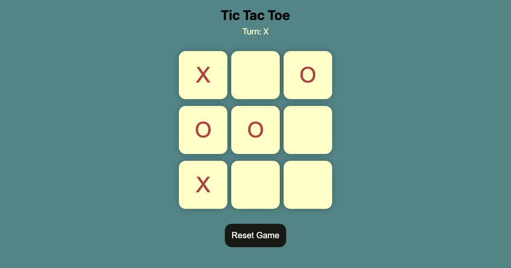

# Tic Tac Toe

[](https://samarthjaiswal.github.io/TicTacToe/)

A two-player Tic Tac Toe game for the browser, written in plain HTML, CSS and JavaScript with no
dependencies or build step. Both players share one screen; O always moves first.

**[Play it →](https://samarthjaiswal.github.io/TicTacToe/)**



## Features

- 3x3 board; players alternate O and X, and a filled square can't be changed.
- "Turn: O / X" indicator above the board.
- Detects all eight winning lines and draws (board full with no winner), then shows a
  "Congratulations, Winner is …" or "Game was a Draw." message and locks the board.
- **New Game** (after a result) and **Reset Game** (any time) buttons clear the board.
- Keyboard-playable: each square is a button labelled with its row, column and contents for
  screen readers; the board resizes for phone screens.

## How to run

Open `index.html` in a browser, or serve the folder locally:

```bash
python3 -m http.server 8000
# open http://localhost:8000
```

It is also live on GitHub Pages, served straight from the `main` branch.

## Project structure

```
TicTacToe/
├── index.html   # board of nine buttons, turn indicator, result message, reset/new-game buttons
├── style.css    # board layout (vmin-based), mobile breakpoint at 600px
└── app.js       # turn handling, win patterns, draw detection, reset
```

## Tech stack

HTML5, CSS3, vanilla JavaScript (ES6).
